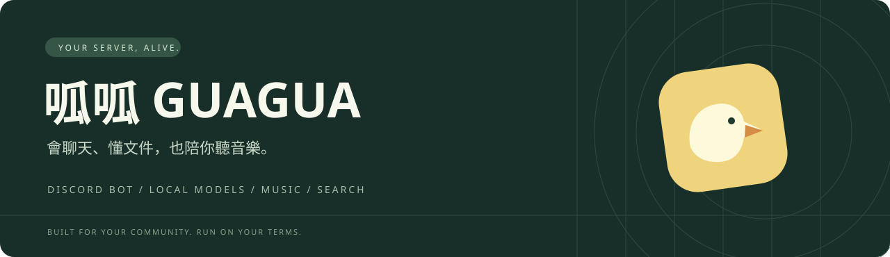
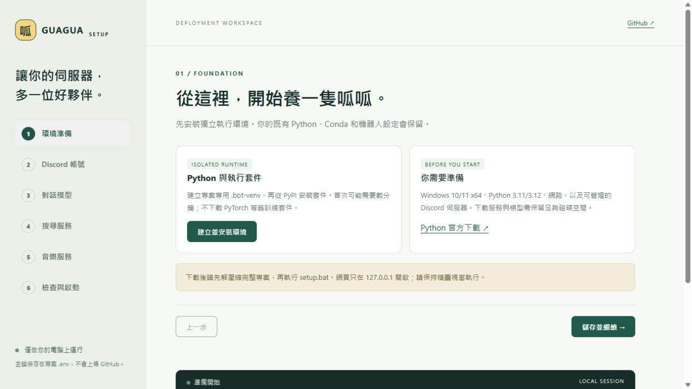
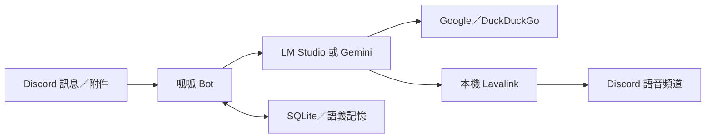

<div align="center">



**一隻住在 Discord 的多功能鴨子。**

本機或雲端對話 · 文件摘要 · 情境搜尋 · 自然語言點歌

[](https://www.python.org/)
[](https://discordpy.readthedocs.io/)
[](LICENSE)

[**快速部署**](#-快速部署) · [**首次設定指南**](docs/getting-started.md) · [**完整功能**](docs/features.md) · [**回報問題**](https://github.com/melvin0kuo/DISCORD-BOT/issues)

</div>

---

## ✨ 不只是聊天

| | 能做什麼 | 試著說 |
|---|---|---|
| 💬 **對話** | LM Studio 本機模型或 Gemini；提及、回覆與私訊皆可互動 | `@呱呱 解釋一下這段程式` |
| 📄 **讀文件** | 文字、PDF、DOCX、XLSX；長文件分段摘要，視覺模型可辨識掃描頁 | 回覆附件：`@呱呱 整理重點與截止日期` |
| 🔎 **查資訊** | SerpApi 的 Google 結果優先，DuckDuckGo 自動備援，附來源 | `@呱呱 台北車站午餐，預算 300 元` |
| 🎵 **聽音樂** | 本機 Lavalink、搜尋、佇列、循環、播放面板與自然語言操作 | 加入語音後：`@呱呱 幫我放晴天` |
| 🧠 **留住脈絡** | SQLite 記憶與個人資料；本機語義記憶使用 Nomic embeddings | `/查看記憶` |
| 👥 **人物記憶** | 已知稱呼對應同一 ID；引用可讀頻道的管理事件與具名評論，評論不當作事實 | `@呱呱 starpig之前發生什麼趣事？` |
| 🛡️ **權限與狀態** | 音樂同頻道檢查、私有資訊防護，顯示搜尋／點歌等處理階段 | `🔎 搜尋中…` → `✍️ 整理回覆中…` |

## 🚀 快速部署

**新手建議：Windows x64 ＋ Gemini 起步，不需要本機 GPU。**

### 1 · 下載

[下載專案 ZIP](https://github.com/melvin0kuo/DISCORD-BOT/archive/refs/heads/main.zip)，**完整解壓縮**後開啟資料夾。也可以：

```bash
git clone https://github.com/melvin0kuo/DISCORD-BOT.git
cd DISCORD-BOT
```

### 2 · 雙擊 `setup.bat`

本機瀏覽器會開啟 **部署工作台**。需要 Python 3.11／3.12；若未安裝，啟動器提供 WinGet 官方套件安裝引導。

```text
環境準備 → Discord 帳號 → 對話模型 → 搜尋服務 → 音樂服務 → 檢查與啟動
```

精靈幫你建立 `.bot-venv`、安裝執行套件、保存設定、準備音樂服務並檢查連線。每一步都有官方帳號／API 申請入口與說明。



> **一鍵開啟、逐步設定。** 帳號註冊、登入、驗證碼、條款，以及大型模型下載仍需本人完成。精靈不會代購方案、不要求 Discord 個人帳號密碼，也不會把本機設定網站公開到網路。

### 3 · 填入自己的服務設定

| 必要性 | 項目 | 官方入口 |
|---|---|---|
| **必要** | Discord Bot Token；啟用 Message Content 與 Server Members Intent | [Discord Developer Portal](https://discord.com/developers/applications) |
| **二選一** | Gemini API Key，或已下載模型的 LM Studio | [AI Studio](https://aistudio.google.com/apikey) · [LM Studio](https://lmstudio.ai/download) |
| 選填 | SerpApi API Key；未填時使用 DuckDuckGo | [SerpApi](https://serpapi.com/users/sign_up) |

按「儲存並檢查連線」，將 Bot 邀請到伺服器，再按「啟動機器人」。在 Discord 確認上線後就能聊天；播放音樂前請先加入語音頻道。

**需要逐步畫面說明、權限與疑難排解？閱讀 [第一次部署指南 →](docs/getting-started.md)**

## 🧭 選擇你的部署方式

| | Gemini 雲端 | LM Studio 本機 |
|---|---|---|
| 適合 | 想先快速上線的人 | 想自行掌控模型與運算的人 |
| 硬體 | 不需本機 GPU | 依模型大小與 context 準備 RAM／VRAM |
| 前置作業 | 申請 API Key，確認可用模型與額度 | 安裝 LM Studio，下載具工具呼叫能力的模型 |
| 使用限制 | 依供應商地區、額度與計費規則 | 依硬體、模型能力與本機服務狀態 |
| 語義記憶 | 使用既有 Gemini 路徑，依 API 可用性 | 需載入 `text-embedding-nomic-embed-text-v1.5` |

本機聊天不消耗 Gemini 對話額度；搜尋與線上音源仍需網路。圖片／掃描 PDF 需要支援視覺輸入的模型。

## 🎛️ 常用操作

| 操作 | 指令 |
|---|---|
| 搜尋並播放 | `/play` |
| 暫停／繼續 | `/pause` · `/resume` |
| 換歌／查看佇列 | `/skip` · `/queue` |
| 音量／循環 | `/volume` · `/loop` |
| 停止／離開 | `/stop` · `/leave` |
| 自動推薦（預設關閉） | `/autoplay` |

也可以直接說「@呱呱 下一首」。自然語言控制需要直接提及 Bot，並與 Bot 位於同一語音頻道。舊播放面板不能操控新播放器。

## 🧩 原理很簡單



`main.py` 是入口，`cogs/` 放 Discord 功能，`utils/` 放模型、音樂與搜尋服務。`setup_wizard.py` 和 `setup_ui/` 是僅使用標準函式庫啟動的本機部署工作台。

## 🔐 設定留在本機

- 金鑰存於 `.env`，設定頁只顯示是否已保存；空白欄位保留既有金鑰。
- 精靈僅監聽 `127.0.0.1`，每次產生新的工作階段；請勿分享啟動網址。
- 不必授予 Bot Administrator。以頻道可見、發訊息、讀取歷史、語音連線及說話權限起步。
- 私有資訊查詢以 Discord 應用擁有者驗證，限擁有者私訊；金鑰仍會遮蔽。注入防護只能降低風險，不能保證阻擋所有攻擊。
- 生成額度依使用者跨頻道累計：10 分鐘最多 12 次、180 秒、16,000 字；1 小時最多 40 次、600 秒、48,000 字，任一項達上限便暫停，隨滾動視窗恢復。單次最多 120 秒；一般故事／字幕最多 4,000 字、80 個非空白行，文件分析／程式說明最多 8,000 字、160 行，並受剩餘額度限制。明確超額的生成要求會先請使用者分批，生成途中超額則停止；被中止或丟棄的輸出仍計入。用量與超限原因保存在 `data/generation_usage.db` 30 天，重啟保留已完成請求紀錄；用量超額不等同違規，不增加濫用標記。生成時間包含模型排隊與工具等待；部署前的舊紀錄不追溯計費。
- 明確要求無限／大量重複或洗版時，會在模型執行前拒絕、標記使用者 ID 並提及警告；正常「繼續」與長文不會單獨觸發。紀錄存於 `data/abuse_flags.db`，自動警告每人最多每分鐘一次。擁有者可用 `!abuse_status @使用者`、`!abuse_clear @使用者` 查詢／解除，或 `!abuse_mark @使用者 原因` 手動標記並立即提及對方警告；三者亦接受數字 ID。通知僅允許提及被標記者，不會通知原因中的其他提及；不會自動禁言、封鎖或踢人。
- 濫用判斷包含「輪流到斷氣」及近期同頻道濫用後的氣長／耐力變形要求，正常音樂循環不視為文字洗版。另有發送前重複輸出檢查：模型大量重複短字串時只送出停止提示，不把該回答寫入對話記憶；程式碼區塊不以重複字元直接判定。此輸出保護本身不會自動認定使用者有惡意。
- 人物評論存於 `data/people_memory.db`，只記錄明確提及已辨識人物的短陳述，保留評論者、日期與來源訊息；問句、敏感資料與提示詞指令不記為人物評論。檢索僅限當前伺服器的當前頻道，且提問者需要讀取歷史權限；不把私密頻道資訊帶到公開頻道，私訊紀錄不跨使用者分享。每人每伺服器保留最多 100 筆，回答最多取近期 5 筆；不代表完整記錄所有語意或能自動理解代詞「他」。改名保留已見稱呼，歧義名稱需改用 @。擁有者可用 `!people_memory @使用者` 查詢；任何人可用 `!people_forget` 清除關於自己的評論，擁有者可指定目標。此操作不會刪除原訊息、管理事件或既有對話記憶。
- `.env`、資料庫與日誌不要上傳。已被 Git 追蹤的舊檔案仍需自行檢查；`.gitignore` 不會自動移除它們。

## 📌 使用前知道這些

<details>
<summary><strong>文件、搜尋與音樂的實際限制</strong></summary>

- 每次最多四個附件，每檔 10 MB；每份最多擷取 200,000 字元，長文件先分段摘要。PDF 前 200 頁、掃描辨識最多 30 頁；關鍵數字需核對原件。
- 只讀取當次訊息及明確回覆的附件，不會自行遍歷整個頻道。
- 餐廳／店家查詢優先使用 SerpApi Google Maps 的分店地址、營業狀態與時間，標示永久／暫停營業的分店列為不可推薦；今日休息與永久停業分開處理。店家查詢要求 SerpApi 略過舊快取，本機快取兩分鐘；一般網頁快取十分鐘，保留來源日期並提示較舊／日期不明資料。Maps 失敗時仍可切換 DuckDuckGo，但普通網頁的店家會標示「營業狀態未確認」。地圖、價格、營業時間與空位仍可能異動，查詢時間不是來源更新時間。
- YouTube 可能受到登入、地區或平台改版影響。安裝器無法保證每首歌可播放，請使用合法且可取得的音源。
- 本機 YouTube 備援串流遇到 CDN 暫時錯誤時，最多重試兩次；403／410 只更新同一影片音訊網址一次，仍受 CDN 網址白名單驗證。重試仍失敗才結束該次備援，不會改成其他歌曲或無限重試。
- 原曲與備援都失敗後會跳過並接播佇列下一首，空佇列且開啟自動推薦時才嘗試推薦；失敗歌曲在本輪排除，單曲／佇列循環不會重試它。連續三首失敗則暫停接播並保留剩餘佇列，重新手動點歌可再次嘗試。
- 一鍵工具主要支援 Windows 10/11 x64；Linux／macOS 需手動準備環境。精靈不提供雲端主機、開機自啟或公網控制台。

詳細範圍、設定與行為見[完整功能文件](docs/features.md)。

</details>

## 🛠️ 開發與驗證

```bash
python -m pip install -r requirements-bot.txt
python -m pip install -r requirements-dev.txt
python -m pytest
python -m ruff check main.py config.py setup_wizard.py cogs utils tests --select F821,F823,E9
```

自動測試使用暫存資料與替代服務，不需要真實金鑰。舊診斷腳本不屬於自動測試套件。已有環境可沿用 `start_with_lavalink.bat`；不要與精靈重複啟動同一個 Bot。

---

由 [melvin0kuo](https://github.com/melvin0kuo) 維護 · [MIT License](LICENSE) · [部署指南](docs/getting-started.md) · [完整功能](docs/features.md)
